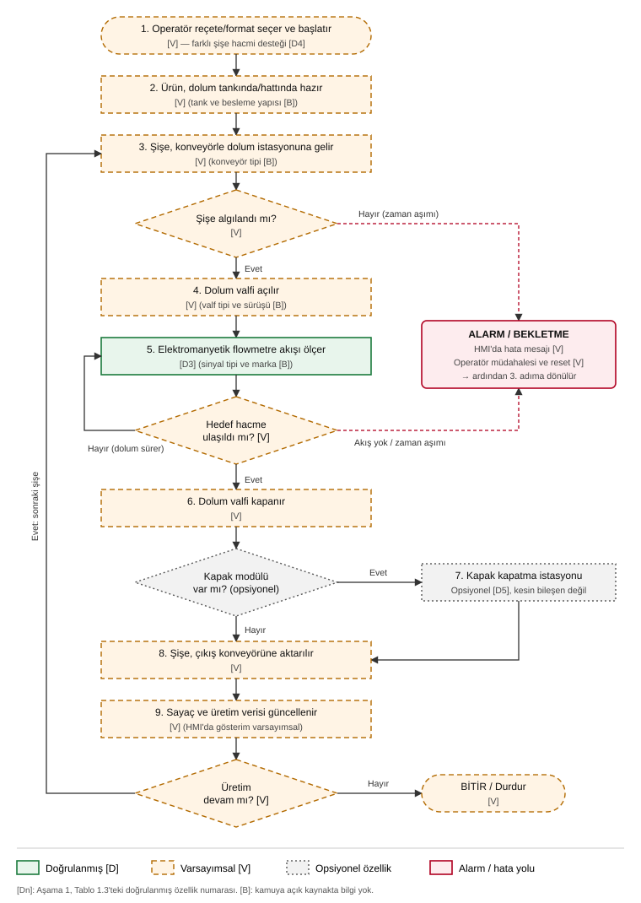
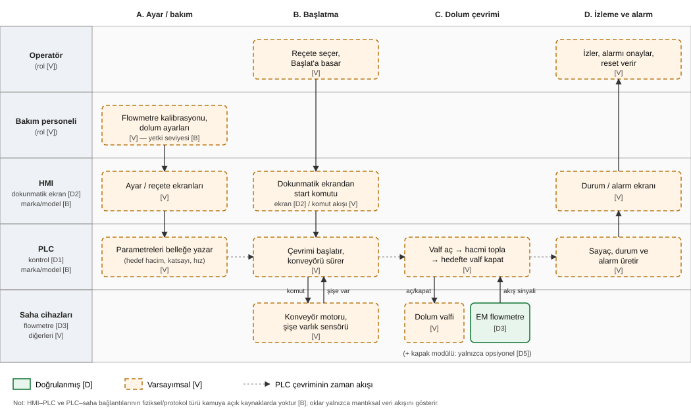
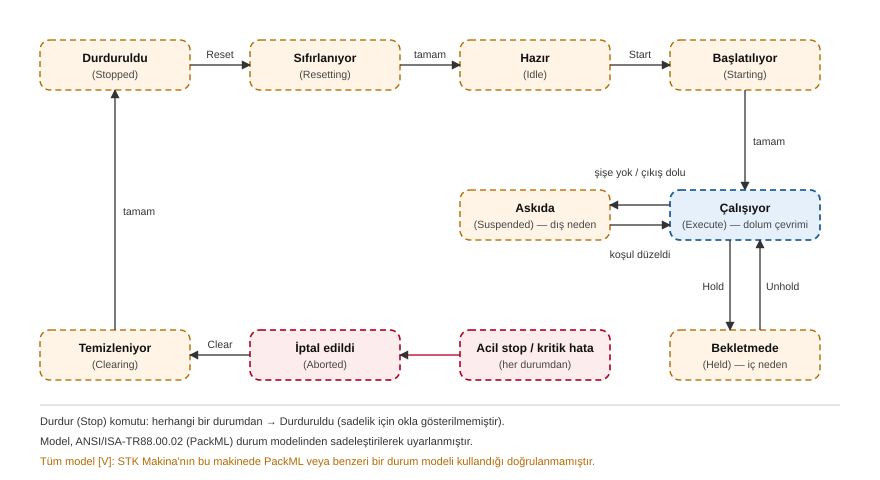

# 2. MAKİNENİN SÜREÇ MODELLEMESİ

> Etiketler: **[D]** doğrulanmış (kamuya açık kaynakta açıkça yazıyor) · **[B]** bilinmiyor · **[V]** varsayımsal (sektör uygulamasından çıkarım; doğrulanmadı) · **[Dn]** Tablo 1.3'teki doğrulanmış özellik no.
> Bu bölümdeki hata durumları **operasyonel hata modlarıdır**; doğrulanmış güvenlik zafiyeti değildir.

## 2.1 Amaç ve yöntem
Bu bölüm, makinenin üretici tarafından doğrulanmış işlevlerini (D1–D8) temel alarak bir süreç modeli kurar. Üreticinin kamuya açık kaynaklarında bulunmayan adımlar; PLC tabanlı dolum makineleri üzerine yayımlanmış akademik çalışmalar [10], elektromanyetik flowmetreli dolum uygulamalarına ilişkin üretici dokümanları [8] ve ambalaj makineleri için tanımlanmış ANSI/ISA-TR88.00.02 (PackML) durum modeli [9] referans alınarak **varsayımsal [V]** olarak modellenmiştir. Kapak kapatma, üretici tarafından "seçenek" olarak sunulduğundan [1] modelde **opsiyonel** gösterilmiştir.

## 2.2 Çalışma sürecinin adım adım tanımı

| Adım | Açıklama | Etiket | Dayanak |
|---|---|---|---|
| 1 | Operatör, şişe hacmine uygun reçete/format seçer ve üretimi başlatır | [V] (farklı hacim desteği [D4]) | [1] |
| 2 | Sıvı ürün (süt, ayran, meyve suyu) dolum tankında/hattında hazırdır | [V] (ürün türleri [D6]) | [1] |
| 3 | Boş şişe konveyörle dolum istasyonuna taşınır | [V] | [10] |
| 4 | Şişe varlık sensörü şişeyi algılar; algılanmazsa dolum başlamaz | [V] | [10] |
| 5 | PLC dolum valfini açar | [V] | — |
| 6 | Elektromanyetik flowmetre geçen ürün miktarını ölçer | **[D3]** | [1], [8] |
| 7 | Hedef hacme ulaşılınca PLC valfi kapatır | [V] | [8] |
| 8 | *(Opsiyonel)* Kapak kapatma istasyonu şişeyi kapatır | **Opsiyonel [D5]** | [1] |
| 9 | Dolu şişe çıkış konveyörüne/sonraki makineye aktarılır | [V] | — |
| 10 | Üretim sayacı ve durum bilgisi güncellenir, HMI'da gösterilir | [V] (HMI varlığı [D2]) | [1] |

**Ölçüm ilkesine ilişkin not:** Elektromanyetik flowmetreler yalnızca elektriksel olarak iletken sıvılarda çalışır. Örneğin dolum uygulamalarına yönelik bir üretici dokümanında en düşük iletkenlik ≥ 5 µS/cm olarak verilmektedir [8]. Süt ve meyve suyu iletken sıvılardır; bu durum makinenin hedef ürünleriyle [D6] tutarlıdır. STK Makina'nın kullandığı flowmetrenin markası ve modeli ise **[B]**'dir.

## 2.3 Girdi–İşlem–Çıktı (IPO) tablosu

**Tablo 2.1 – Girdi–İşlem–Çıktı tablosu**

| Kategori | Öğe | Açıklama | Etiket |
|---|---|---|---|
| **Girdi** | Sıvı ürün | Süt, ayran, meyve suyu, diğer sıvı gıdalar | [D6] |
| Girdi | Boş şişe | Farklı hacimlerde | [D4] |
| Girdi | Kapak | Yalnızca kapak modülü varsa | Opsiyonel [D5] |
| Girdi | Operatör komutları | Reçete seçimi, başlat/durdur, alarm onayı | [V] |
| Girdi | Ayar parametreleri | Hedef hacim, flowmetre kalibrasyon katsayısı, hat hızı | [V] |
| Girdi | Elektrik enerjisi | Gerilim ve güç değerleri | [V] / değerler [B] |
| Girdi | Basınçlı hava | Valf veya kapak mekanizması için | [V] |
| Girdi | CIP (yerinde temizlik) suyu/kimyasalı | Hijyenik temizlik döngüsü | [V] |
| **İşlem** | Şişe taşıma ve konumlama | Konveyör ile | [V] |
| İşlem | Şişe algılama | Varlık sensörü | [V] |
| İşlem | Hacimsel dolum ölçümü | Elektromanyetik flowmetre | **[D3]** |
| İşlem | Dolum valfi kontrolü | PLC çıkışlarıyla aç/kapat | [V] (PLC [D1]) |
| İşlem | Kapak kapatma | Kapak modülü varsa | Opsiyonel [D5] |
| İşlem | İzleme, sayma, alarm | PLC mantığı ve HMI ekranı | [V] (PLC [D1], HMI [D2]) |
| **Çıktı** | Dolu şişe | Kapaklı veya kapaksız (konfigürasyona göre) | [D] (kapak opsiyonel) |
| Çıktı | Üretim verisi | Sayaç, hız, dolum adedi | [V] |
| Çıktı | Alarm ve olay bilgisi | HMI'da gösterilen hata mesajları | [V] |
| Çıktı | Fire/red ürün | Eksik/fazla dolu veya dökülmüş şişe | [V] |
| Çıktı | Atık su | CIP sonrası | [V] |

## 2.4 Süreç akış diyagramı

**Şekil 2.1 –** Otomatik şişe dolum makinesinin süreç akış diyagramı. Yeşil kutu doğrulanmış [D] adımı, kesikli turuncu kutular varsayımsal [V] adımları, gri noktalı kutular opsiyonel özelliği, kırmızı yollar alarm/hata akışını gösterir. *(Kaynak: Yazar tarafından [1], [8], [10] temel alınarak hazırlanmıştır.)*

## 2.5 Operatör–HMI–PLC etkileşimleri

**Şekil 2.2 –** Rol ve bileşen bazlı kulvar (swimlane) diyagramı. Oklar mantıksal veri akışını gösterir; fiziksel bağlantı ve protokol türü **[B]**'dir. *(Kaynak: Yazar; [1], [10].)*

**Tablo 2.2 – Etkileşim tablosu**

| No | Kaynak → Hedef | Etkileşim | Veri türü | Etiket |
|---|---|---|---|---|
| E1 | Bakım personeli → HMI | Kalibrasyon katsayısı, dolum ayarları | Parametre yazma | [V] |
| E2 | HMI → PLC | Ayar/reçete parametrelerinin aktarımı | Parametre yazma | [V] |
| E3 | Operatör → HMI | Reçete seçimi, başlat/durdur | Komut | [V] (dokunmatik ekran [D2]) |
| E4 | HMI → PLC | Start/stop komutu | Komut | [V] |
| E5 | PLC → konveyör, valf | Hareket ve valf aç/kapat | Dijital/analog çıkış | [V] |
| E6 | Şişe sensörü → PLC | Şişe var/yok | Dijital giriş | [V] |
| E7 | Flowmetre → PLC | Akış/hacim sinyali | Darbe veya analog sinyal (tür [B]) | **[D3]** ölçüm / sinyal [B] |
| E8 | PLC → HMI | Sayaç, durum, alarm | İzleme verisi | [V] |
| E9 | HMI → Operatör | Ekranda durum/alarm gösterimi | Görsel bilgi | [V] |
| E10 | Operatör → HMI → PLC | Alarm onayı ve reset | Komut | [V] |

**Kullanıcı rolleri ve yetkiler:** Üretici sayfasında operatör ve bakım rolleri ya da HMI'da kullanıcı/parola seviyeleri hakkında bilgi yoktur **[B]**. Rol ayrımı bu raporda **[V]** olarak modellenmiştir. Rollerin yetki sınırları Aşama 3 (varlık envanteri) ve Aşama 5'teki "meraklı, sınırlı yetkili iç kullanıcı" profili için temel girdi olacaktır.

## 2.6 Makine durum modeli

**Şekil 2.3 –** PackML'den uyarlanmış, sadeleştirilmiş makine durum modeli **[V]**. *(Kaynak: Yazar; ANSI/ISA-TR88.00.02 kavramlarından uyarlanmıştır [9].)*

PackML, ISA-88 standardının ambalaj makinelerine uyarlanmış hâlidir. Makine durumları, modlar ve veri yapıları (PackTags) için ortak bir model tanımlar [9]. Bu modelde iki duraklama türü ayrılır. **Askıda (Suspended)** durumu dış nedenlerden kaynaklanır; örneğin şişe gelmemesi ya da çıkış hattının dolması. **Bekletmede (Held)** durumu ise iç nedenlerden kaynaklanır; örneğin operatör müdahalesi veya ürün beslemesinin kesilmesi. Bu ayrım, Aşama 6'da "süreci durdurma" tipi tehdit senaryolarını sınıflandırmak için kullanılacaktır. Durum adları ve geçişleri standarttan sadeleştirilerek alınmıştır. Standardın tam metni ücretlidir ve tam durum listesi standarttan doğrulanmalıdır.

## 2.7 Olası hata durumları (operasyonel)

**Tablo 2.3 – Operasyonel hata durumları**

| No | Hata durumu | Olası neden | Etki | Algılama | Tepki / durum | Etiket |
|---|---|---|---|---|---|---|
| HD1 | Şişe gelmemesi / konveyörde sıkışma | Mekanik sıkışma, besleme kesintisi | Üretim durur | Şişe sensörü zaman aşımı | Askıda → Alarm | [V] |
| HD2 | Şişe yokken dolum | Sensör arızası veya yanlış konum | Ürün kaybı, hijyen sorunu | Sensör ile valf kilidi (interlock) | Valf açılmamalı | [V] |
| HD3 | Eksik veya fazla dolum | Yanlış kalibrasyon katsayısı, flowmetre arızası, hava kabarcığı, düşük iletkenlik | Ürün kalitesi, müşteri ve yasal dolum toleransları | Hacim/süre sapması | Alarm, red | [V] (flowmetre [D3]; iletkenlik şartı [8]) |
| HD4 | Valfin kapanmaması | Valf veya aktüatör arızası, sinyal kaybı | Taşma, ürün kaybı, kayma riski | Hedef aşıldı / zaman aşımı | İptal (acil durum) | [V] |
| HD5 | Ürün beslemesinin kesilmesi | Tank boş, pompa arızası | Eksik dolum | Akış yok | Bekletmede | [V] |
| HD6 | Yanlış reçete/format seçimi | Operatör hatası | Hatalı hacim, şişe taşması | Operatör veya kalite kontrol | Durdur, reçete düzelt | [V] |
| HD7 | Kapak takılamaması / eğik kapak | Kapak beslemesi, mekanizma | Sızdırma, kontaminasyon | Kapak sensörü (varsa) | Red / Alarm | **Yalnızca opsiyonel modül varsa** [D5] / [V] |
| HD8 | Çıkış hattının dolması | Sonraki makinenin durması | Şişe birikmesi | Çıkış sensörü | Askıda | [V] |
| HD9 | HMI–PLC iletişim kaybı | Kablo, ağ veya cihaz arızası | Operatör süreci göremez | HMI iletişim hatası | PLC güvenli duruma geçmeli | [V] (bağlantı türü [B]) |
| HD10 | Enerji veya basınçlı hava kesintisi | Şebeke ya da kompresör arızası | Belirsiz valf konumu | Basınç/enerji izleme | Güvenli duruş | [V] |
| HD11 | Acil stop | Operatör veya emniyet olayı | Ani duruş | Acil stop devresi | İptal → Temizleniyor | [V] (acil stop varlığı [B]) |
| HD12 | CIP sonrası kalıntı / eksik temizlik | Döngü hatası | Gıda güvenliği riski | Proses kaydı | Üretime başlamama | [V] |

> **Not:** Bu hata durumları kaza veya arıza kaynaklıdır. HD3 (kalibrasyon katsayısı), HD6 (reçete) ve HD9 (iletişim) gibi bazıları kasıtlı olarak da tetiklenebilir. Bu ihtimaller, doğrulanmış zafiyet olarak değil **olası risk** olarak Aşama 6'da ele alınacaktır.

## 2.8 Aşama 2 varsayımlar kaydı

| No | Varsayım | Gerekçe | Doğrulama durumu |
|---|---|---|---|
| V2.1 | Şişeler konveyörle taşınır | PLC tabanlı dolum makinelerinde yaygın yapı [10] | Doğrulanmadı |
| V2.2 | Şişe varlık sensörü vardır | Aynı yerde [10] | Doğrulanmadı |
| V2.3 | Dolum valfi PLC çıkışıyla açılıp kapanır | EM flowmetreli dolum uygulama mantığı [8] | Doğrulanmadı |
| V2.4 | Reçete/format ve kalibrasyon parametreleri HMI üzerinden girilir | HMI [D2] ile farklı hacim [D4] özelliklerinin birlikte bulunması; benzer sistemlerde ayarların HMI'dan girilmesi [10] | Doğrulanmadı |
| V2.5 | Operatör ve bakım rolleri ayrıdır | Genel endüstriyel uygulama | Doğrulanmadı, yetki yapısı [B] |
| V2.6 | Makine PackML benzeri bir durum mantığıyla çalışır | Ambalaj makineleri için tanımlı model [9] | Doğrulanmadı; yalnızca modelleme aracı |
| V2.7 | Basınçlı hava ve CIP altyapısı kullanılır | Süt sektörü dolum hatlarının genel yapısı; firmanın CIP ünitesi ürettiğini beyan etmesi [3] | Doğrulanmadı |

## Kaynaklar (birleşik numaralandırma)

[1] STK Makina, "Şişe Dolum Makinesi," ürün sayfası. https://www.stkmakina.com/sise-dolum-makinesi (Erişim: 20.10.2026)
[2] STK Makina, Ana sayfa. https://www.stkmakina.com/ (Erişim: 20.10.2026)
[3] STK Makina, "Hakkımızda." https://www.stkmakina.com/hakkimizda-p-2 (Erişim: 20.10.2026)
[4] STK Makina, "Belgelerimiz." https://www.stkmakina.com/belgelerimiz-p-10 (Erişim: 20.10.2026)
[5] STK Makina, "Ayran ve Yoğurt Sütü Dolum." https://www.stkmakina.com/ayran-ve-yogurt-sutu-dolum (Erişim: 20.10.2026)
[6] STK Makina, "STK Makina Dijital Katalog," PDF, 2024. https://www.stkmakina.com/foto/1779257448-STK%20Makina%20Dijital%20Katalog.pdf (Erişim: 20.10.2026)
[7] STK Makina, "Dolum ve Paketleme." https://www.stkmakina.com/dolum-ve-paketleme (Erişim: 20.10.2026)
[8] KROHNE, "BATCHFLUX 5500 – Electromagnetic flowmeter for filling applications," ürün dokümanı. https://krohne.com/kp-71-en (Erişim: 20.10.2026)
[9] ANSI/ISA-TR88.00.02, *Machine and Unit States: An Implementation Example of ANSI/ISA-88.00.01* (PackML). Erişilen ikincil kaynaklar: OPC Foundation, "OPC 30050 PackML – Packaging Control," https://opcfoundation.org/developer-tools/documents/view/209 ; "PackML," Wikipedia, https://en.wikipedia.org/wiki/PackML (Erişim: 20.10.2026)
[10] S. Kusumastuti vd., "Control and monitor bottle filling, capping and labelling machine using a programmable logic controller and human machine interface," *Jurnal Polimesin*, c. 22, sy. 5, 2024. DOI: 10.30811/jpl.v22i5.5210
