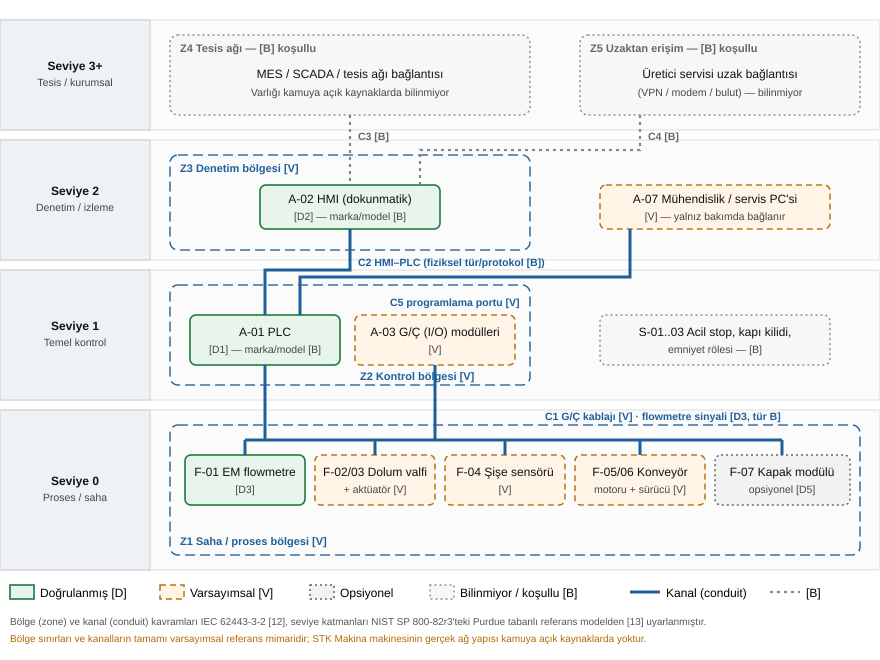

# 3. VARLIK ENVANTERİ

> Etiketler: **[D]** doğrulanmış · **[B]** bilinmiyor · **[V]** varsayımsal · **[Dn]** Tablo 1.3'teki doğrulanmış özellik no.
> "Olası riskler" sütunu **doğrulanmış zafiyet değildir**; varlığın türüne göre literatürde bilinen risk kategorilerini gösterir. Doğrulanmış zafiyet (CVE/duyuru) incelemesi Aşama 6'da yapılacaktır.

## 3.1 Amaç ve yöntem

Varlık envanteri, sonraki SWOT, tehdit senaryosu ve risk analizi aşamalarının ortak referansıdır. Yöntem, CISA ve ortak kuruluşların 2025 tarihli OT varlık envanteri rehberindeki beş adıma dayanır [11]: (1) kapsam ve hedeflerin tanımlanması, (2) varlıkların belirlenip özniteliklerinin toplanması, (3) varlıkların sınıflandırılması için taksonomi oluşturulması, (4) verinin yönetimi, (5) yaşam döngüsü yönetimi. Bu çalışmada 1–3. adımlar uygulanmıştır. 4. ve 5. adımlar, makinenin sahibi olan işletmenin sorumluluğundadır ve öneri olarak Aşama 9'da ele alınacaktır.

**Yöntemsel sınırlama:** Rehber, varlıkların fiziksel inceleme ve ağ tabanlı keşifle belirlenmesini önerir [11]. Bu proje kuralları gereği makineye ya da firmaya erişilmemiş, tarama yapılmamıştır. Envanter yalnızca **belge tabanlıdır**. Rehberin "yüksek öncelikli" saydığı özniteliklerin çoğu (IP/MAC adresi, işletim sistemi, port/servis, kullanıcı hesapları, protokoller, üretici/model) bu makine için **[B]**'dir. Bu boşluk, SWOT'ta zayıf yön ve risk analizinde belirsizlik kaynağı olarak kullanılacaktır.

**Sınıflandırma:** Rehberde iki sınıflandırma yaklaşımı yer alır: kritiklik tabanlı ve işlev tabanlı [11]. Bu çalışmada ikisi birlikte kullanılmıştır:
- **İşlev tabanlı kategoriler:** Kontrol donanımı (A), saha cihazları (F), emniyet varlıkları (S), yazılım/ürün yazılımı (SW), veri ve parametreler (P), haberleşme kanalları (N), insan ve roller (R), fiziksel/proses varlıkları (PR), destek hizmetleri (U), dokümantasyon ve tedarik (DOC).
- **Bölge ve kanal:** IEC 62443-3-2 yaklaşımıyla varlıklar ortak güvenlik gereksinimine sahip bölgelere (zone), haberleşme yolları ise kanallara (conduit) ayrılmıştır [12], [11]. Seviye katmanları NIST SP 800-82r3'teki Purdue tabanlı referans modelden uyarlanmıştır [13].

## 3.2 Varlık durumu ve kritiklik ölçütleri

**Tablo 3.1a – Varlık durumu sınıfları**

| Durum | Anlamı | Envanterde gösterim |
|---|---|---|
| **[D]** Mevcut, doğrulanmış | Üretici kaynağında açıkça belirtilmiş | Yeşil |
| **[D]→** Zorunlu sonuç | Doğrulanmış bir özelliğin teknik olarak zorunlu kıldığı varlık (ör. PLC varsa PLC programı da vardır). Özellikleri ise [B]'dir | Yeşil, açıklamalı |
| **[V]** Varsayımsal | Bu tür makinelerde yaygın; bu makinede doğrulanmamış | Turuncu |
| **[B]** Koşullu / bilinmiyor | Varlığı da yokluğu da bilinmiyor. **Makinede mevcut sayılmaz**; analizde "eğer varsa" senaryosu olarak ele alınır | Gri |
| **Ops.** Opsiyonel | Üretici tarafından seçenek olarak sunulmuş [D5] | Gri noktalı |

**Tablo 3.1b – Kritiklik boyutları**

Kritiklik üç düzeyde (Yüksek / Orta / Düşük) değerlendirilmiştir. Bu üç düzey CISA rehberindeki sınıflandırmayla uyumludur [11]. OT sistemlerinde öncelik sırası bilgi sistemlerinden farklıdır: insan emniyeti ve süreç sürekliliği, gizlilikten önce gelir [13]. Bu nedenle dört boyut kullanılmıştır:

| Kısaltma | Boyut | Soru |
|---|---|---|
| **E** | Emniyet (Safety) | Varlığın arızası veya ele geçirilmesi insan yaralanmasına yol açabilir mi? |
| **S** | Süreklilik (Availability) | Üretim durur mu? |
| **B** | Bütünlük / gıda güvenliği (Integrity) | Yanlış dolum, kontaminasyon ya da hatalı ürün oluşur mu? |
| **G** | Gizlilik (Confidentiality) | Reçete, üretim verisi veya kimlik bilgisi açığa çıkar mı? |

**Genel kritiklik = dört boyuttaki en yüksek değer.** Bu ihtiyatlı (maksimum) kural yazarın tercihidir. Puanlar varsayımsal mimariye göre verilmiştir ve gerçek konfigürasyonda değişebilir.

## 3.3 Bölge ve kanal referans modeli

**Şekil 3.1 –** Varsayımsal bölge (zone) ve kanal (conduit) referans modeli. *(Kaynak: Yazar; [11], [12], [13] temel alınarak hazırlanmıştır.)*

**Tablo 3.2 – Bölgeler ve kanallar**

| ID | Ad | İçerdiği varlıklar | Durum |
|---|---|---|---|
| Z1 | Saha / proses bölgesi | F-01…F-09 | [V] (F-01 [D3]) |
| Z2 | Kontrol bölgesi | A-01, A-03, SW-01, SW-03 | [V] (A-01 [D1]) |
| Z3 | Denetim bölgesi | A-02, SW-02, P-01…P-07 (HMI'da görüntülenen/girilen) | [V] (A-02 [D2]) |
| Z4 | Tesis / kurumsal ağ | MES/SCADA, tesis ağı | **[B] koşullu** |
| Z5 | Uzaktan erişim | Üretici servisi uzak bağlantısı | **[B] koşullu** |
| C1 | PLC ↔ saha G/Ç kablajı | Dijital/analog sinyaller, flowmetre sinyali | [V]; flowmetre sinyali [D3], türü [B] |
| C2 | HMI ↔ PLC | Komut, parametre, durum verisi | Bağlantı [D]→ (iki cihaz birlikte çalıştığına göre var); fiziksel tür ve protokol [B] |
| C3 | Makine ↔ tesis ağı | Üretim verisi aktarımı | **[B] koşullu** |
| C4 | Uzaktan erişim kanalı | Servis bağlantısı | **[B] koşullu** |
| C5 | Programlama/servis portu | PLC programı yükleme/indirme | [V] |

> Not: Emniyet varlıkları (S-01…S-03) kasıtlı olarak bölgelere atanmamıştır, çünkü varlıkları [B]'dir. IEC 62443 uygulamasında emniyet sistemleri genellikle ayrı bir bölge olarak ele alınır [11]; bu konu Aşama 7'de değerlendirilecektir.

## 3.4 Varlık envanteri tabloları

Sütunlar: **Durum** (Tablo 3.1a) · **E/S/B/G** (Tablo 3.1b; Y=Yüksek, O=Orta, D=Düşük, –=ilgisiz) · **Genel** kritiklik · **İz**: Aşama 2'deki süreç adımı, etkileşim (E#) veya hata durumu (HD#) bağlantısı.

### 3.4.1 Kontrol donanımı (A)

**Tablo 3.3**

| ID | Varlık | Görev | Durum | E/S/B/G | Genel | Olası riskler (doğrulanmamış) | İz |
|---|---|---|---|---|---|---|---|
| A-01 | PLC | Dolum çevrimini, valf ve konveyör kontrolünü, sayaçları yönetir | **[D1]**; marka, model ve ürün yazılımı [B] | Y/Y/Y/O | **Yüksek** | Mantık değişikliği, yetkisiz program yükleme, hizmet dışı kalma, yama eksikliği | Adım 5–7, E2/E4–E8, HD4/HD9 |
| A-02 | HMI (dokunmatik ekran) | Reçete seçimi, başlat/durdur, durum ve alarm gösterimi | **[D2]**; marka, model ve işletim sistemi [B] | O/Y/Y/O | **Yüksek** | Yetkisiz parametre değişikliği, zayıf veya varsayılan parola, ekranın kilitlenmesi, yanıltıcı gösterim | E1–E4, E8–E10, HD6/HD9 |
| A-03 | PLC G/Ç (I/O) modülleri | Saha sinyallerini PLC'ye bağlar | [V] | O/Y/O/– | **Orta** | Arıza, kablo veya bağlantı hatası, sinyal manipülasyonu (fiziksel erişimle) | C1 |
| A-04 | Elektrik / kontrol panosu | PLC, sürücü ve güç bileşenlerini barındırır | [V] | Y/Y/–/– | **Yüksek** | Yetkisiz fiziksel erişim, elektrik çarpması, nem/ıslak ortam etkisi | — |
| A-05 | Güç kaynağı (24 V DC) / UPS | Kontrol devrelerini besler | [V]; UPS [B] | O/Y/–/– | **Orta** | Enerji kesintisi, belirsiz duruş | HD10 |
| A-06 | Ağ anahtarı (switch) / ağ cihazı | HMI–PLC'yi veya tesis ağını bağlar | **[B] koşullu** | –/O/O/O | **Orta** (varsa) | Yönetilmeyen anahtar, segmentasyon eksikliği | C2/C3 |
| A-07 | Mühendislik / servis bilgisayarı | PLC/HMI programlama, yedekleme, arıza giderme | [V] (geçici bağlanır) | O/Y/Y/O | **Yüksek** | Zararlı yazılım taşıma, yetkisiz program değişikliği, kayıp/çalıntı | C5, SW-04 |

### 3.4.2 Saha cihazları (F)

**Tablo 3.4**

| ID | Varlık | Görev | Durum | E/S/B/G | Genel | Olası riskler (doğrulanmamış) | İz |
|---|---|---|---|---|---|---|---|
| F-01 | Elektromanyetik flowmetre | Dolan ürün hacmini ölçer | **[D3]**; marka, sinyal türü ve dijital arayüz [B] | –/Y/Y/– | **Yüksek** | Kalibrasyon kayması, düşük iletkenlikte ölçüm hatası [8], konfigürasyon değişikliği (dijital arayüz varsa) | Adım 6, E7, HD3 |
| F-02 | Dolum valfi | Ürün akışını açar ve keser | [V]; tipi [B] | O/Y/Y/– | **Yüksek** | Açık kalma ve taşma, sızdırma, hijyen sorunu | Adım 5/7, HD4 |
| F-03 | Valf aktüatörü / solenoid valf | Valfi pnömatik veya elektrikle sürer | [V] | O/Y/Y/– | **Yüksek** | Hava veya enerji kesintisinde belirsiz konum | HD4/HD10 |
| F-04 | Şişe varlık sensörü | Şişe yokken dolumu engeller | [V] | O/Y/Y/– | **Yüksek** | Yanlış algılama, sensör köprüleme (bypass), kirlenme | Adım 4, E6, HD1/HD2 |
| F-05 | Konveyör motoru | Şişeleri taşır | [V] | Y/Y/–/– | **Yüksek** | Sıkışma, hareketli parçaya temas | HD1/HD8 |
| F-06 | Motor sürücüsü (frekans invertörü) | Konveyör hızını ayarlar | [V] | O/Y/O/– | **Orta** | Parametre değişikliği, ağ arayüzü (varsa) | E5 |
| F-07 | Kapak kapatma modülü | Şişeyi kapatır | **Ops. [D5]**; konfigürasyonda bulunmayabilir | O/O/Y/– | **Orta** (varsa) | Eksik veya eğik kapak, kontaminasyon | Adım 8, HD7 |
| F-08 | Kapak sensörü | Kapak varlığını/doğruluğunu denetler | [V]; **yalnızca F-07 varsa** | –/O/O/– | **Orta** (varsa) | Hatalı kabul/red | HD7 |
| F-09 | Tank seviye sensörü / ürün besleme | Ürün beslemesinin sürekliliğini izler | [V] | –/O/O/– | **Orta** | Boş tankla çalışma, eksik dolum | Adım 2, HD5 |

### 3.4.3 Emniyet varlıkları (S)

**Tablo 3.5**

| ID | Varlık | Görev | Durum | E/S/B/G | Genel | Olası riskler (doğrulanmamış) | İz |
|---|---|---|---|---|---|---|---|
| S-01 | Acil stop düğmesi/devresi | Tehlike anında makineyi durdurur | **[B]**: kamuya açık kaynakta yok | Y/O/–/– | **Yüksek** (varsa) | Devre dışı bırakma, köprüleme, arıza | HD11 |
| S-02 | Koruyucu kapak ve kilit/sensörü | Hareketli parçalara erişimi engeller | **[B]** | Y/O/–/– | **Yüksek** (varsa) | Köprüleme, mekanik hasar | — |
| S-03 | Emniyet rölesi / emniyet PLC'si | Emniyet fonksiyonlarını yürütür | **[B]** | Y/O/–/– | **Yüksek** (varsa) | Standart PLC ile birleşik tasarım, yetkisiz değişiklik | — |

> S-01…S-03 makinede **mevcut olarak gösterilmemiştir**. Bu tür makineler için yasal emniyet gereklilikleri Aşama 7'de [14] üzerinden ele alınacaktır. "Olması gereken" ile "doğrulanmış olan" arasındaki fark, SWOT'ta bir belirsizlik olarak işlenecektir.

### 3.4.4 Yazılım ve ürün yazılımı (SW)

**Tablo 3.6**

| ID | Varlık | Görev | Durum | E/S/B/G | Genel | Olası riskler (doğrulanmamış) | İz |
|---|---|---|---|---|---|---|---|
| SW-01 | PLC uygulama programı | Dolum mantığı, kilitlemeler, zaman aşımları | **[D]→** (A-01'in zorunlu sonucu); içeriği [B] | Y/Y/Y/O | **Yüksek** | Yetkisiz değişiklik, yedeksizlik, fikri mülkiyet sızıntısı | Tüm çevrim |
| SW-02 | HMI projesi / ekran yazılımı | Ekranlar, reçete arayüzü, alarm metinleri | **[D]→** (A-02'nin zorunlu sonucu); içeriği [B] | O/Y/Y/O | **Yüksek** | Ekran manipülasyonu, parola saklama zafiyeti | E1–E4, E8–E10 |
| SW-03 | PLC/HMI ürün yazılımı ve işletim sistemi | Cihazların temel yazılımı | **[D]→**; sürümü [B] | O/Y/Y/– | **Yüksek** | Güncellenmemiş sürüm, yayımlanmış CVE'ler (marka bilinmediği için eşleştirilemiyor) | — |
| SW-04 | Mühendislik/programlama yazılımı | PLC/HMI programlama aracı | [V] (A-07 üzerinde) | O/Y/Y/O | **Yüksek** | Lisans/sürüm sorunları, proje dosyası sızıntısı | C5 |
| SW-05 | Flowmetre/sürücü konfigürasyon dosyaları | Cihaz parametreleri | [V] | –/O/Y/– | **Orta** | Yanlış konfigürasyon geri yükleme | F-01/F-06 |

### 3.4.5 Veri ve üretim parametreleri (P)

**Tablo 3.7**

| ID | Varlık | Görev | Durum | E/S/B/G | Genel | Olası riskler (doğrulanmamış) | İz |
|---|---|---|---|---|---|---|---|
| P-01 | Reçete/format parametreleri (hedef hacim, şişe tipi) | Farklı şişe hacimlerine uyum | [V] (işlev [D4]) | –/O/Y/O | **Yüksek** | Yanlış veya kasıtlı değiştirilmiş hacim; tüketici ve yasal dolum toleransı ihlali | Adım 1, E3, HD6 |
| P-02 | Flowmetre kalibrasyon katsayısı | Ölçümü gerçek hacme çevirir | [V] | –/O/Y/– | **Yüksek** | Fark edilmesi zor, sistematik eksik/fazla dolum | E1, HD3 |
| P-03 | Hat hızı / zamanlama parametreleri | Çevrim süresi, konveyör hızı | [V] | O/O/O/– | **Orta** | Sıkışma, taşma | E2 |
| P-04 | Alarm limitleri ve zaman aşımı değerleri | Hata algılama eşikleri | [V] | O/O/Y/– | **Yüksek** | Eşiklerin gevşetilmesiyle hataların gizlenmesi | HD1–HD5 |
| P-05 | Üretim sayaçları ve verileri | Adet, verim, fire | [V] | –/D/O/O | **Orta** | Kayıt manipülasyonu, izlenebilirlik kaybı | Adım 10, E8 |
| P-06 | Alarm ve olay kayıtları (log) | Arıza ve müdahale geçmişi | [V]; kayıt tutulup tutulmadığı [B] | –/D/O/D | **Orta** | Kaydın olmaması, silinmesi; adli inceleme zorluğu | E8–E10 |
| P-07 | Kullanıcı hesapları ve parolaları (HMI) | Rol bazlı erişim | **[B]**: kullanıcı yönetimi olup olmadığı bilinmiyor | O/O/Y/Y | **Yüksek** (varsa) | Paylaşılan, varsayılan veya zayıf parola; parolasız erişim | E1/E3 |
| P-08 | PLC/HMI program yedekleri | Felaket sonrası geri dönüş | [V] | –/Y/O/O | **Orta** | Yedeksizlik, güncel olmayan yedek, yedeğin sızması | SW-01/SW-02 |

### 3.4.6 Haberleşme kanalları (N)

Haberleşme kanalları Tablo 3.2'de (C1–C5) bölge-kanal modeliyle birlikte verilmiştir. Kritiklikleri:

**Tablo 3.8**

| ID | Kanal | Durum | Genel | Olası riskler (doğrulanmamış) |
|---|---|---|---|---|
| C1 | PLC ↔ saha G/Ç | [V] / flowmetre sinyali [D3] | **Yüksek** | Fiziksel müdahale, sinyal bozulması |
| C2 | HMI ↔ PLC | [D]→ bağlantı / tür [B] | **Yüksek** | Ethernet tabanlıysa kimlik doğrulamasız endüstriyel protokol ihtimali (tür bilinmediği için [V]) |
| C3 | Makine ↔ tesis ağı | **[B] koşullu** | **Yüksek** (varsa) | Kurumsal ağdan OT'ye yanal hareket |
| C4 | Uzaktan erişim | **[B] koşullu** | **Yüksek** (varsa) | Sürekli açık uzak bağlantı, paylaşılan kimlik bilgisi |
| C5 | Programlama/servis portu | [V] | **Yüksek** | Yetkisiz dizüstü/USB bağlantısı |

### 3.4.7 İnsan ve roller (R)

**Tablo 3.9**

| ID | Rol | Görev | Durum | Erişim (varsayımsal) | Genel | Olası riskler (doğrulanmamış) |
|---|---|---|---|---|---|---|
| R-01 | Operatör | Reçete seçimi, başlat/durdur, izleme, alarm onayı | [V] | HMI: işletim ekranları | **Orta** | Hatalı reçete seçimi, merakla ayar ekranlarına girme; **Aşama 5'teki beşinci profilin temeli** |
| R-02 | Bakım personeli | Kalibrasyon, arıza giderme, parça değişimi | [V] | HMI ayar ekranları, pano, olası programlama portu | **Yüksek** | Geniş yetki, emniyet köprüleme, servis dizüstüsünün kontrolsüz kullanımı |
| R-03 | Üretim / kalite sorumlusu | Reçete onayı, dolum toleransı kontrolü | [V] | Raporlar, reçete onayı | **Orta** | Yetersiz denetim |
| R-04 | Üretici servis teknisyeni (STK Makina) | Devreye alma, satış sonrası destek | Hizmetin varlığı **[D]** [3]; makineye erişim biçimi [B] | Yerinde veya uzaktan ([B]) | **Yüksek** | Üçüncü taraf erişimi, tedarik zinciri riski |
| R-05 | Temizlik / CIP personeli | Hijyenik temizlik döngüleri | [V] | Makine çevresi, olası CIP ekranı | **Düşük** | Yanlış temizlik döngüsü |
| R-06 | Müşteri BT/OT yöneticisi | Ağ ve hesap yönetimi | **[B]** | Ağ altyapısı | **Orta** (varsa) | Sorumluluk belirsizliği (BT mi OT mi?) |

> Rollerin yetki sınırları ve HMI'da kullanıcı seviyesi olup olmadığı **[B]**'dir. Tablodaki erişim sütunu varsayımsaldır.

### 3.4.8 Fiziksel/proses, destek ve dokümantasyon varlıkları (PR, U, DOC)

**Tablo 3.10**

| ID | Varlık | Durum | E/S/B/G | Genel | Olası riskler (doğrulanmamış) |
|---|---|---|---|---|---|
| PR-01 | Sıvı ürün (süt, ayran, meyve suyu) | **[D6]** | –/O/Y/– | **Yüksek** | Kontaminasyon, yanlış dolum, ürün kaybı |
| PR-02 | Şişeler (farklı hacimler) | **[D4]** | –/O/O/– | **Orta** | Yanlış format, kırık şişe |
| PR-03 | Kapaklar | **Ops. [D5]** | –/O/O/– | **Düşük** (varsa) | Uyumsuz kapak |
| PR-04 | Dolum tankı / ürün hattı | [V] | O/Y/Y/– | **Yüksek** | Hijyen, boş tank |
| PR-05 | CIP sistemi | [V]; firma CIP üniteleri ürettiğini beyan ediyor [3] | O/O/Y/– | **Orta** | Eksik temizlik, kimyasal kalıntı |
| U-01 | Elektrik enerjisi | [V] (değerler [B]) | O/Y/–/– | **Yüksek** | Kesinti, dalgalanma |
| U-02 | Basınçlı hava | [V] | O/Y/O/– | **Orta** | Basınç kaybı, valf belirsizliği |
| U-03 | Su / CIP kimyasalları | [V] | O/O/Y/– | **Orta** | Kimyasal maruziyet, kalıntı |
| DOC-01 | Kullanım ve bakım kılavuzu | [V]: makine emniyeti mevzuatı kılavuzu zorunlu kılar [14], ancak bu makinenin kılavuzu kamuya açık değil | O/O/–/O | **Orta** | Kılavuzun eksik veya erişilemez olması |
| DOC-02 | Elektrik şemaları, PLC program dokümanı | [V] | –/O/–/O | **Orta** | Sızması saldırgana keşif bilgisi sağlar |
| DOC-03 | CE uygunluk beyanı / teknik dosya | **[B]**: firma genel "CE" beyanında bulunuyor [6], makineye özel beyan doğrulanamadı | Y/–/–/– | **Orta** | Uyumluluk belirsizliği |
| DOC-04 | Satış sonrası hizmet ve yedek parça tedariki | Hizmet **[D]** [3]; kapsamı [B] | –/Y/–/– | **Orta** | Tedarikçi bağımlılığı, gecikme |

## 3.5 Envanter özeti

**Tablo 3.11 – Durum ve kritiklik dağılımı**

| Kategori | Toplam | [D] / [D]→ | [V] | [B] koşullu | Ops. | Yüksek | Orta | Düşük |
|---|---|---|---|---|---|---|---|---|
| A – Kontrol donanımı | 7 | 2 | 4 | 1 | 0 | 4 | 3 | 0 |
| F – Saha cihazları | 9 | 1 | 7 | 0 | 1 | 5 | 4 | 0 |
| S – Emniyet | 3 | 0 | 0 | 3 | 0 | 3 | 0 | 0 |
| SW – Yazılım | 5 | 3 | 2 | 0 | 0 | 4 | 1 | 0 |
| P – Veri/parametre | 8 | 0 | 7 | 1 | 0 | 4 | 4 | 0 |
| C – Kanallar | 5 | 1 | 2 | 2 | 0 | 5 | 0 | 0 |
| R – Roller | 6 | 1 | 4 | 1 | 0 | 2 | 3 | 1 |
| PR/U/DOC | 12 | 3 | 7 | 1 | 1 | 3 | 8 | 1 |
| **Toplam** | **55** | **11** | **33** | **9** | **2** | **30** | **23** | **2** |

> Sayım notu: F-08 [V] olarak sayılmıştır ama yalnızca F-07 opsiyonel modülü varsa geçerlidir. R-04'ün hizmet varlığı [D], erişim biçimi [B]'dir; [D] sütununda sayılmıştır.

**Değerlendirme:**
- 55 varlığın yalnızca **11'i (%20)** doğrulanmış veya doğrulanmış bir özelliğin zorunlu sonucudur. Bu oran, Aşama 1'de belirtilen bilgi eksikliğini sayısal olarak gösterir.
- Doğrulanmış en kritik üç varlık **A-01 PLC, A-02 HMI ve F-01 elektromanyetik flowmetre**dir. Bunların marka, model ve ürün yazılımı [B] olduğu için cihaza özgü CVE eşleştirmesi yapılamamaktadır.
- **Emniyet varlıklarının (S) tamamı ve ağ dış bağlantılarının (C3, C4) varlığı bilinmiyor.** Bunlar SWOT'ta "belirsizlik" ve risk analizinde "eğer varsa" senaryoları olarak işlenecektir.
- Gıda güvenliği açısından en hassas varlıklar **P-01 reçete, P-02 kalibrasyon katsayısı ve P-04 alarm limitleri**dir. Bu parametrelerin değişmesi süreci durdurmadan ürün kalitesini bozabilir. Bu, Aşama 6 için önemli bir senaryo ekseni olacaktır.

## 3.6 Sonraki aşamalara aktarım

**Tablo 3.12 – Envanterin sonraki aşamalarda kullanımı**

| Aşama | Kullanılacak envanter öğeleri |
|---|---|
| 4 – SWOT / TOWS | Doğrulanmış özellikler (A-01, A-02, F-01, D4, D5) → güçlü yönler; [B] kalemleri (S-01…S-03, P-07, SW-03, DOC-03) → zayıf yönler/belirsizlik; C3/C4 ve R-04 → dış tehditler; standartlar [11]–[13] → fırsatlar |
| 5 – Tehdit aktörleri | R-01…R-06 roller; beşinci profil "meraklı, sınırlı yetkili iç kullanıcı" R-01 ile A-02, P-01…P-04 üzerinden |
| 6 – Zafiyet ve senaryolar | Yüksek kritik varlıklar; kanallar C1–C5; Aşama 2'deki HD3/HD6/HD9 |
| 7 – Safety/Security | S-01…S-03, F-02/F-03/F-05, A-04 |
| 8 – Risk matrisi | Varlık ID'leri risk kayıtlarının birincil anahtarı olacak |
| 9 – Önlemler/gereksinimler | Bölge-kanal modeli (Şekil 3.1), CISA rehberinin 4. ve 5. adımları [11] |

## Kaynaklar (birleşik numaralandırma — devam)

[1]–[10]: Bkz. Bölüm 1 ve 2.

[11] CISA, NSA, FBI, EPA, ASD's ACSC, Cyber Centre, BSI, NCSC-NL, NCSC-NZ, *Foundations for OT Cybersecurity: Asset Inventory Guidance for Owners and Operators*, Ağustos 2025. https://www.cisa.gov/sites/default/files/2025-08/joint-guide-foundations-for-OT-cybersecurity-asset-inventory-guidance_508c.pdf (Erişim: 20.10.2026)
[12] IEC 62443-3-2:2020, *Security for industrial automation and control systems – Part 3-2: Security risk assessment for system design*, IEC, 2020. https://webstore.iec.ch/en/publication/30727 (Standardın tam metni ücretlidir; bu çalışmada katalog açıklaması ve [11]'deki özetinden yararlanılmıştır.)
[13] K. Stouffer vd., *Guide to Operational Technology (OT) Security*, NIST SP 800-82 Rev. 3, NIST, Eylül 2023. DOI: 10.6028/NIST.SP.800-82r3. https://csrc.nist.gov/pubs/sp/800/82/r3/final
[14] Makine Emniyeti Yönetmeliği (2006/42/AT), T.C. Resmî Gazete, 03.03.2009, Sayı 27158. *(Aşama 7'de ayrıntılı ele alınacak; künye o aşamada doğrulanacaktır.)*
