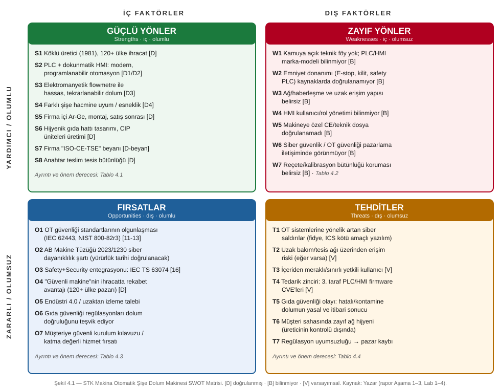

# 4. SWOT ANALİZİ VE TOWS STRATEJİLERİ

> **Etiketler:** [D] doğrulanmış (üretici/kamuya açık kaynak) · [B] bilinmiyor · [V] varsayımsal · [D-beyan] firma beyanı, bağımsız doğrulanmadı.
> **Kapsam:** Çalışma yalnızca kamuya açık kaynaklarla yapılmıştır; firmayla iletişim kurulmamış, test yapılmamıştır. Varsayımsal riskler doğrulanmış güvenlik açığı olarak sunulmamıştır.
> **Önem derecesi ölçeği:** ● Yüksek · ◐ Orta · ○ Düşük (yazarın değerlendirmesi).

## 4.1 Amaç ve yöntem

SWOT analizi, hedef makineyi dört boyutta değerlendirir: **iç faktörler** (Güçlü/Zayıf yönler — firmanın ve makinenin kendi kontrolündeki özellikler) ve **dış faktörler** (Fırsat/Tehdit — çevreden, pazardan, regülasyondan ve tehdit ortamından gelen etkenler). Analiz dört düzeyde kurulmuştur: firma, makine, OT güvenliği ve dış çevre. Bulgular önceki aşamalardan beslenir: süreç modeli (Aşama 2), varlık envanteri (Aşama 3) ve Lab 1–4.

Bu çalışmanın ayırt edici yanı, **bilgi eksikliğini bir analiz nesnesi olarak ele almasıdır**: makinenin iç yapısına ait birçok özellik kamuya açık kaynaklarda bulunmadığından ([B]), bu belirsizlikler "zayıf yön" değil, çoğunlukla **"belirsizlik kaynaklı zayıflık"** olarak işlenmiştir. Burada "zayıf yön", makinenin kötü olduğu anlamına gelmez; **kamuya açık kaynaktan doğrulanamayan ve bu nedenle güvenlik açısından risk oluşturabilecek** nokta demektir.

**Şekil 4.1 –** STK Makina Otomatik Şişe Dolum Makinesi SWOT matrisi (özet). Ayrıntılar Tablo 4.1–4.4'te.

---

## 4.2 Güçlü Yönler (Strengths) — iç, olumlu

**Tablo 4.1**

| Kod | Güçlü yön | Gerekçe | Kaynak/Durum | Önem | İyileştirme / kaldıraç önerisi |
|---|---|---|---|---|---|
| **S1** | Köklü ve deneyimli üretici | 1981'den beri faaliyette, 120+ ülkeye ihracat; süt ve gıda makinelerinde uzmanlık | [D] [2][3] | ● | Kurumsal itibarı "güvenli makine" konumlandırmasıyla pekiştir |
| **S2** | Modern, programlanabilir otomasyon | PLC kontrollü + dokunmatik HMI | [D1][D2] [1] | ● | PLC/HMI tabanı, güvenlik sertleştirmesi (hardening) için uygun bir temel |
| **S3** | Yüksek dolum hassasiyeti | Elektromanyetik flowmetre ile hacimsel ölçüm; ürün kaybını azaltır | [D3] [1][8] | ● | Hassasiyeti gıda güvenliği/dolum toleransı uyumu için pazarlanabilir değer |
| **S4** | Ürün esnekliği | Farklı şişe hacimlerine uyum | [D4] [1] | ◐ | Reçete yönetimi; güvenli reçete bütünlüğü ile birleştirilebilir |
| **S5** | Dikey entegre yetkinlik | Firma içi Ar-Ge, tasarım, montaj, devreye alma, satış sonrası | [D] [3] | ● | Güvenliği tasarım aşamasında ekleme (security-by-design) imkânı |
| **S6** | Hijyenik tasarım ve CIP yetkinliği | Gıda hattına uygun, CIP üniteleri üretimi | [D] [3] | ◐ | Hijyen + güvenlik "güvenli ve temiz üretim" olarak birlikte sunulabilir |
| **S7** | Uyumluluk beyanı | Firma "ISO-CE-TSE" ifadesini kullanıyor | [D-beyan] [6] | ◐ | Makineye özel belgelerle somutlaştırılmalı (bkz. W5) |
| **S8** | Anahtar teslim tesis yetkinliği | Makine, bütünleşik tesisin parçası olarak sunuluyor | [D] [3] | ◐ | Tüm tesis için tutarlı bölge/kanal mimarisi fırsatı |

**Değerlendirme:** Güçlü yönler esas olarak **kurumsal olgunluk (S1, S5, S8)** ve **doğrulanmış otomasyon temeli (S2, S3, S4)** etrafında toplanır. Bu temel, güvenlik iyileştirmelerinin sıfırdan değil, mevcut yapı üzerine inşa edilebileceğini gösterir — bu, TOWS'ta SO stratejilerinin dayanağıdır.

---

## 4.3 Zayıf Yönler (Weaknesses) — iç, olumsuz

**Tablo 4.2**

| Kod | Zayıf yön | Gerekçe | Kaynak/Durum | Önem | İyileştirme önerisi |
|---|---|---|---|---|---|
| **W1** | Kamuya açık teknik şeffaflık eksikliği | Ürün sayfasında teknik föy yok; PLC/HMI marka-modeli, kapasite, meme sayısı belirtilmemiş | [B] [1][6] | ◐ | Analiz tarafı: varsayımsal mimari kullan. Üretici tarafı: teknik föy yayımla |
| **W2** | Emniyet donanımının doğrulanamaması | Acil stop, koruyucu kapak kilidi, safety PLC kamuya açık kaynakta yok | [B] (Aşama 3, S-01…S-03) | ● | Makine emniyeti değerlendirmesi; emniyet fonksiyonunun belgelenmesi (Lab 1) |
| **W3** | Ağ/haberleşme belirsizliği | HMI–PLC protokolü, tesis ağı ve uzak erişim yapısı bilinmiyor | [B] (Aşama 3, C2–C4) | ● | Bölge/kanal mimarisi tanımlama (Lab 2); segmentasyon gereksinimi |
| **W4** | Kullanıcı/rol yönetiminin belirsizliği | HMI'da parola/rol seviyesi olup olmadığı bilinmiyor | [B] (Aşama 3, P-07) | ● | Rol bazlı erişim kontrolü gereksinimi; varsayılan parolaların kaldırılması |
| **W5** | Makineye özel uyumluluk belgesinin görünmemesi | Genel "CE" beyanı var, makineye özel teknik dosya/beyan doğrulanamadı | [B] (Aşama 3, DOC-03) | ◐ | CE teknik dosyasına siber dayanıklılık bölümü eklenmesi (O2 ile) |
| **W6** | OT güvenliğinin iletişimde yer almaması | Firma pazarlamasında siber güvenlik/OT güvenliği vurgusu görünmüyor | [B] [2][3] | ◐ | "Güvenli makine" mesajı ve kurulum rehberi (O4, O7) |
| **W7** | Veri bütünlüğü korumasının belirsizliği | Reçete ve flowmetre kalibrasyon katsayısının yetkisiz değişime karşı korunması bilinmiyor | [B] (Aşama 3, P-01/P-02; Lab 3 R2) | ● | Parametre değişikliği yetkilendirme + kaydı; bütünlük kontrolü |

**Değerlendirme:** Zayıf yönlerin neredeyse tamamı **[B] belirsizlik** kaynaklıdır; bu, makinenin kusurlu olduğunu değil, **kamuya açık kaynaktan güvenlik güvencesi verilemediğini** gösterir. En kritikleri (W2, W3, W4, W7) doğrudan Lab 1–4 ve Aşama 6 risk senaryolarıyla örtüşür ve WO/WT stratejilerinin hedefidir.

---

## 4.4 Fırsatlar (Opportunities) — dış, olumlu

**Tablo 4.3**

| Kod | Fırsat | Gerekçe | Kaynak/Durum | Önem | İlişki |
|---|---|---|---|---|---|
| **O1** | OT güvenliği standartlarının olgunlaşması | IEC 62443 serisi, NIST SP 800-82r3, CISA OT varlık rehberi uygulanabilir çerçeveler sunuyor | [D] [11][12][13] | ● | SO/WO stratejileri; Aşama 9 |
| **O2** | Regülasyonun siber dayanıklılık talebi | AB Makine Tüzüğü 2023/1230, kontrol sistemlerinin bozulmaya (corruption) karşı korunmasını zorunlu kılıyor | [D], **yürürlük tarihi doğrulanacak** [15] | ● | CE teknik dosyası; W5 ile |
| **O3** | Safety + Security entegrasyonu | IEC TS 63074, emniyet fonksiyonlarını hedef alan siber tehditlerin değerlendirilmesini sağlar | [D] [16] | ◐ | Lab 1/Lab 4; Aşama 7 |
| **O4** | "Güvenli makine" rekabet avantajı | 120+ ülke ihracat pazarında güvenlik, satın alma kriteri hâline geliyor | [D] (ihracat) + [V] (pazar eğilimi) | ● | S1/S5 ile; ihracat farklılaşması |
| **O5** | Endüstri 4.0 / uzaktan izleme talebi | Uzaktan izleme değer katar — güvenli tasarlanırsa | [V] | ◐ | Dikkat: güvensizse T2'ye döner |
| **O6** | Gıda güvenliği regülasyonları | Dolum doğruluğu ve izlenebilirlik talebi, S3 hassasiyetini değere çevirir | [V] | ◐ | S3 ile |
| **O7** | Katma değerli güvenli kurulum hizmeti | Müşteriye güvenli kurulum kılavuzu/servisi yeni gelir kalemi olabilir | [V] | ◐ | W6/T6 ile |

**Değerlendirme:** Fırsatların çoğu **regülasyon ve standart baskısının (O1, O2, O3)** bir "zorunluluk"tan çok bir **farklılaşma kaldıracına (O4, O7)** çevrilebilmesinden doğar. Erken uyum sağlayan üretici, ihracat pazarında avantaj kazanır.

---

## 4.5 Tehditler (Threats) — dış, olumsuz

**Tablo 4.4**

| Kod | Tehdit | Gerekçe | Kaynak/Durum | Önem | İlişki |
|---|---|---|---|---|---|
| **T1** | OT'ye yönelik artan siber saldırılar | Endüstriyel kontrol sistemlerine yönelik fidye ve ICS kötü amaçlı yazılım tehdidi genel bir eğilim | [V] (genel eğilim; bu makineye özel doğrulanmış olay yok) | ● | Aşama 6 |
| **T2** | Uzak erişim üzerinden saldırı | Uzak bakım/tesis ağı varsa dış saldırı yüzeyi oluşur | [V] (varlığı [B]) | ● | Lab 3 R1/R3; Lab 4 |
| **T3** | İçeriden meraklı/sınırlı yetkili kullanıcı | Operatörün yetkisiz ayar değişikliği | [V] | ◐ | Lab 3 R2; **Aşama 5 beşinci profil** |
| **T4** | Tedarik zinciri açıkları | 3. taraf PLC/HMI firmware'ında yayımlanmış CVE'ler | [V] (marka [B] olduğu için eşleştirilemiyor) | ◐ | Lab 5; Aşama 6 |
| **T5** | Gıda güvenliği olayının yasal/itibari sonucu | Hatalı veya kontamine dolum; tüketici sağlığı ve dolum toleransı mevzuatı | [V] | ● | Lab 3 R2; S3 ile ters |
| **T6** | Müşteri sahasında zayıf ağ hijyeni | Üreticinin kontrolü dışında; segmentsiz ağ, zayıf parola | [V] | ◐ | O7 ile; kurulum rehberi |
| **T7** | Regülasyon uyumsuzluğu | 2023/1230 gibi şartlara uyulmazsa pazar kaybı | [D] (regülasyon) + [V] (sonuç) | ● | O2 ile (madalyonun iki yüzü) |

**Değerlendirme:** Tehditler iki kümede toplanır: **siber (T1–T4, T6)** ve **uyumluluk/itibar (T5, T7)**. Önemli bir nokta: **bu makineye özel, kamuya açık, doğrulanmış bir siber saldırı veya CVE kaydı bulunamamıştır** (Aşama 1). Dolayısıyla tehditler, "gerçekleşmiş olay" değil, OT alanının genel tehdit ortamına dayanan **olası risklerdir**.

---

## 4.6 SWOT özet değerlendirmesi

- **İç denge:** Güçlü yönler kurumsal ve otomasyon temelinde somut ve doğrulanmış [D]; zayıf yönler ise ağırlıkla güvenlik görünürlüğü ve belirsizlik [B] ekseninde. Yani makine "yetenekli ama güvenlik açısından şeffaf değil" diye özetlenebilir.
- **Dış denge:** Fırsatlar (standart/regülasyon) ile tehditler (siber/uyumsuzluk) büyük ölçüde **aynı eksenin iki yüzüdür**: regülasyona erken uyan için fırsat (O2), geç kalan için tehdit (T7).
- **Stratejik odak:** En yüksek kaldıraç, **belirsizlikleri (W2–W4, W7) standartlar (O1–O3) yardımıyla gidermek** ve bunu ihracatta avantaja (O4) çevirmektir.

---

## 4.7 TOWS Matrisi (strateji üretimi)

TOWS, SWOT'u eyleme dönüştürür: iç ve dış faktörleri eşleştirerek dört strateji türü üretir.

**Tablo 4.5 – TOWS Matrisi**

| | **Fırsatlar (O)** | **Tehditler (T)** |
|---|---|---|
| **Güçlü (S)** | **SO — Saldırgan/geliştirici stratejiler** | **ST — Savunmacı stratejiler** |
| | **SO1:** Doğrulanmış otomasyon temelini (S2, S3) standartlarla (O1, O3) birleştirerek "güvenli ve hassas dolum makinesi" olarak konumlandır → ihracat avantajı (S1+O4). | **ST1:** Dikey entegre Ar-Ge yetkinliğiyle (S5) güvenliği tasarıma göm (security-by-design); artan OT saldırılarına (T1) ve tedarik zinciri CVE'lerine (T4) karşı dayanıklılık kur. |
| | **SO2:** Dolum hassasiyetini (S3) gıda güvenliği regülasyonlarıyla (O6) değere çevir; dolum toleransı uyumunu pazarla. | **ST2:** Hijyen + emniyet + güvenlik bütünlüğünü (S6, S8) kullanarak gıda güvenliği olayı riskini (T5) tasarımla azalt. |
| **Zayıf (W)** | **WO — Dönüştürücü stratejiler** | **WT — Savunmacı/hayatta kalma stratejileri** |
| | **WO1:** Emniyet/ağ/rol belirsizliklerini (W2, W3, W4) IEC 62443 ve NIST 800-82r3 (O1) ile gider; bölge/kanal mimarisi ve rol bazlı erişim tanımla (Lab 2, Lab 4). | **WT1:** En kritik belirsizlikleri (W2, W4, W7) öncelikli kapat ki içeriden kullanıcı (T3) ve uzak erişim (T2) riskleri fiziksel sonuca dönüşmesin (Lab 3 R1/R2). |
| | **WO2:** Makineye özel CE/teknik dosyayı (W5) 2023/1230 siber şartıyla (O2) tamamla; güvenli kurulum kılavuzunu (W6) katma değerli hizmete (O7) çevir. | **WT2:** Reçete/kalibrasyon bütünlüğü korumasını (W7) zorunlu kıl; müşteri sahasındaki zayıf ağ hijyenine (T6) karşı "güvenli varsayılan" yapılandırma ve kılavuz sun. |

---

## 4.8 TOWS → SMART hedefleri ve iyileştirme planı ilişkisi

Aşağıdaki tablo, her stratejiyi ileride (Aşama 10) tanımlanacak SMART hedeflerine ve güvenlik önlemlerine (Aşama 9) bağlar. Bu, SWOT'un "kâğıt üstünde" kalmayıp eyleme döndüğünü gösterir.

**Tablo 4.6 – Strateji → hedef köprüsü**

| Strateji | İlişkili varlık/risk | Önerilen SMART hedef teması (Aşama 10'da somutlaşacak) | Önlem alanı (Aşama 9) |
|---|---|---|---|
| **WO1** | W2, W3, W4 · A-01, A-02, C2–C4 | Bölge/kanal mimarisi ve rol bazlı erişimin tanımlı hâle getirilmesi | Ağ segmentasyonu, erişim kontrolü |
| **WT1** | W2, W7 · Lab 3 R1/R2 | Safety-critical senaryoların (R1) önlem listesinin başına alınması | Emniyet bağımsızlığı, bütünlük |
| **WT2** | W7 · P-01, P-02 | Reçete/kalibrasyon değişikliğinin yetkilendirme+kayıt altına alınması | Değişiklik yönetimi, loglama |
| **SO1** | S2, S3 · O1, O4 | "Güvenli makine" uyum dosyasının hazırlanması | Uyumluluk, dokümantasyon |
| **WO2** | W5 · O2 | CE teknik dosyasına siber dayanıklılık bölümü eklenmesi | Uyumluluk |
| **ST1** | S5 · T1, T4 | Tedarik zinciri/CVE izleme sürecinin kurulması | Zafiyet yönetimi (Lab 5) |

**Öncelik notu:** Hocanın vurguladığı "insana zarar görünür kalmalı" ilkesi (Lab 3 altın kuralı) gereği, **WT1** en yüksek öncelikli stratejidir: düşük olasılıklı ama yüksek emniyet etkili (S=3) senaryoları öne alır.

---

## 4.9 Varsayımlar ve doğrulanacaklar kaydı

| No | Madde | Durum |
|---|---|---|
| V4.1 | T1 "artan OT saldırıları" genel eğilimdir; bu makineye özel doğrulanmış olay yoktur | Doğrulandı: özel olay bulunamadı (Aşama 1) |
| V4.2 | O2 – AB Makine Tüzüğü 2023/1230'un siber şartı ve yürürlük tarihi | **Doğrulanacak** (EUR-Lex resmî metni); Aşama 7'de kesinleştirilecek |
| V4.3 | O4/O5/O6 pazar eğilimleri | Varsayımsal; sektör gözlemine dayanır |
| V4.4 | W-kalemlerinin tamamı makinenin kusuru değil, kamuya açık kaynaktan doğrulanamama durumudur | Yöntemsel ilke |

## Kaynaklar (birleşik numaralandırma — devam)

[1]–[14]: Bkz. Bölüm 1, 2, 3.

[15] Regulation (EU) 2023/1230 of the European Parliament and of the Council on machinery (Makine Tüzüğü). **Not:** Yürürlük/uygulama tarihi ve Ek III'teki ilgili maddeler (kontrol sistemlerinin bozulmaya karşı korunması) resmî EUR-Lex metninden doğrulanacaktır. https://eur-lex.europa.eu/eli/reg/2023/1230/oj
[16] IEC TS 63074:2023, *Safety of machinery – Security aspects related to functional safety of safety-related control systems*, IEC, 2023. https://webstore.iec.ch/publication/69228
